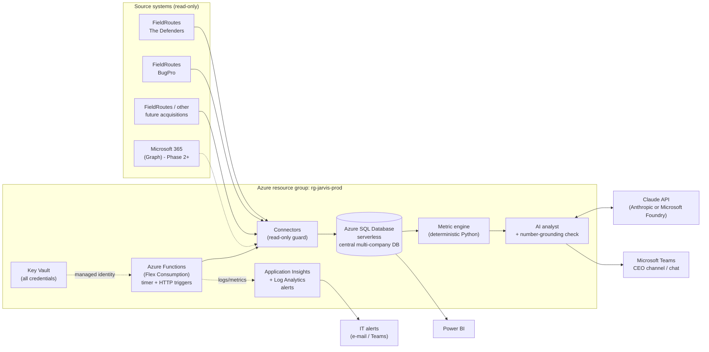
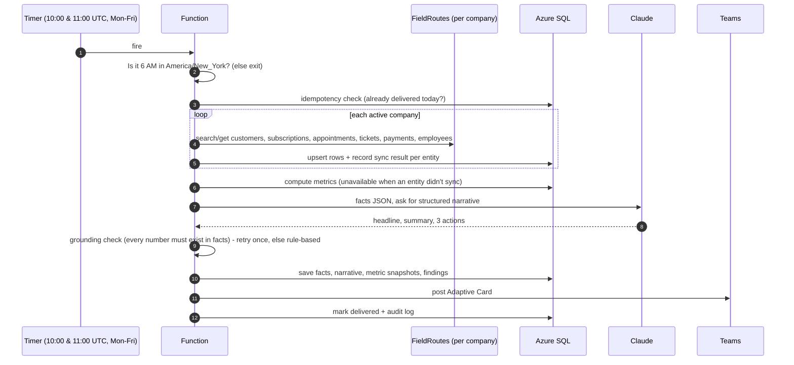

# 1. System Architecture

JARVIS runs entirely in Microsoft Azure on a schedule. No personal computer has to be on. It reads data from business systems (read-only), keeps a central history in its own database, works out the numbers itself, uses an AI model only to explain those numbers, and delivers the results to Microsoft Teams.

## 1.1 High-level diagram

## 1.2 Components

| Component | Technology | Responsibility |
|---|---|---|
| Scheduler & compute | Azure Functions, Flex Consumption plan, Python 3.11 | Runs jobs on a schedule. You pay only while code runs. Includes a manual HTTP trigger for re-runs and backfills. |
| Connectors | `jarvis/connectors/*` | Turn each source system's data into JARVIS's standard format. The FieldRoutes client can only call `search`/`get` endpoints, so it cannot change anything in FieldRoutes. |
| Central database | Azure SQL Database (serverless, free offer to start) | Holds operational history for every company and branch, goals, computed metric snapshots, report runs, agent findings and an audit log. Power BI connects to it directly. |
| Metric engine | `jarvis/metrics/engine.py` | Computes every number from database rows. When a number can't be computed, it is marked **UNAVAILABLE** with a reason. It is never shown as zero. |
| AI analyst | Claude (`claude-opus-5-5`) with structured output | Writes the headline, summary and top 3 actions **from the computed facts only**. A grounding check rejects any number that isn't in the facts. If the AI fails, a rule-based summary is used, so the report still goes out. |
| Delivery | Teams Workflows webhook (Phase 1), Azure Bot (Phase 2) | Posts an Adaptive Card to the CEO channel or chat. Dry-run mode writes files instead. |
| Secrets | Azure Key Vault | Holds FieldRoutes keys, the AI key and the Teams webhook URL. The Function App reads them with its managed identity. |
| Monitoring | Application Insights, Log Analytics, alert rules, Azure budget | Structured logs, alerts on failure, a "report didn't run" alarm, and a monthly cost cap alert. |
| Agent framework | `jarvis/agents/base.py`, `agents` + `agent_findings` tables | A shared contract and permission list for future agents. |

## 1.3 Daily CEO report flow

**Which period a report covers.** Tuesday to Friday reports cover the previous day. Monday's report covers Friday through Sunday, so weekend sign-ups and cancellations are never skipped. Month-to-date always runs from the 1st through the last day covered.

**Why the timer fires twice.** Azure Functions on Linux schedules in UTC. 6 AM Eastern is 10:00 UTC in summer and 11:00 UTC in winter, so the timer fires at both times and the code lets only the run that falls at 6 AM local time proceed. This is DST-safe with no manual changes.

## 1.4 Reliability: retries at every layer

| Layer | Mechanism |
|---|---|
| HTTP to FieldRoutes / Teams | Exponential backoff with jitter on timeouts, HTTP 429 and HTTP 5xx (`tenacity`, up to 5 attempts) |
| Claude API | SDK retries (4), server-side model fallback if the request is declined, one re-prompt if validation fails, then a rule-based summary |
| One data entity fails | Other entities continue. Affected metrics show as UNAVAILABLE with the reason. |
| Whole function fails | Azure Functions retry policy: exponential, 4 retries, 1-10 minutes apart |
| Duplicate protection | `report_runs` is unique per (type, scope, date). A delivered report is never re-sent unless `force=true`. |
| Detection | Alert on any failed run, plus a dead-man's alert if no report has finished by 7 AM Eastern on a weekday |

## 1.5 Designed for growth

**Adding a company** means adding a block to `config/tenants.yaml`, storing its FieldRoutes credentials in Key Vault, and running `python -m jarvis.cli tenants sync`. No code changes and no schema changes. Every table is keyed by `company_id`, and branches map to FieldRoutes offices.

**Adding a data source** (for example QuickBooks, a call-tracking tool, or a different field-service platform at a future acquisition) means writing a connector that implements `DataSource.fetch()` and returns standard rows. Metrics, reports and agents don't change.

**Adding an agent** (retention, cross-sell, technician performance, finance, acquisition integration, onboarding, marketing, scheduling):

1. Register it in the `agents` table with an explicit permission list.
2. Implement `Agent.run()`, reading from the central DB.
3. Write results as `agent_findings` rows.
4. Deliver through the same Teams and audit path.

Anything that acts on the outside world goes through an approval gate. Customer-facing actions are not in the permission list at all.

| Future capability | Main data it needs | Fits on |
|---|---|---|
| Customer retention agent | appointments (missed/rescheduled), payments (failed), cancellations, tenure | existing tables |
| Cross-selling agent | subscriptions by customer (pest only, no lawn or mosquito) | existing tables |
| Technician performance | appointments, invoices, later callbacks and re-services | existing tables, plus a callbacks entity |
| Financial analysis | invoices, payments, AR, later accounting system | new connector |
| Acquisition integration monitor | metric_snapshots before and after `companies.acquired_on` | existing tables |
| Employee onboarding | Microsoft Graph (users, groups, Teams, SharePoint) | Graph connector + approval |
| Marketing performance | lead source on customers, later ad platforms | existing tables + new connector |
| Executive scheduling & tasks | Graph calendar and Planner / To Do | Graph connector + approval |

Phase 2 replaces the one-way webhook with an **Azure Bot** registered as a Teams app. Executives can then ask follow-up questions ("Why is St. Johns behind?"). The bot answers with read-only tool calls against the central database, under the same grounding rule.

## 1.6 Key design decisions

| Decision | Chosen | Alternatives considered | Why |
|---|---|---|---|
| Compute | Azure Functions, Flex Consumption | Container Apps Jobs, Logic Apps, VM | Cheapest for short scheduled jobs (inside the free grant). Native timers and retries. Managed identity. Linux Consumption is being retired in favor of Flex. |
| Database | Azure SQL serverless | PostgreSQL Flexible Server, Cosmos DB | Native Power BI connector, Entra-only (passwordless) auth, free offer, auto-pause. Relational data suits finance-style reporting. |
| Numbers vs AI | Deterministic engine + AI narrative + grounding check | Let the AI query data and compute | "Never fabricate numbers" is enforced by code, not by asking the AI to be careful |
| AI provider | Claude via Anthropic API (switchable to Microsoft Foundry) | Azure OpenAI | Strong analytical writing and structured output. Foundry keeps billing inside Azure if preferred: set `JARVIS_AI_PROVIDER=foundry`. |
| Teams delivery (Phase 1) | Teams Workflows webhook | Graph `ChannelMessage.Send`, Bot | Graph does not let an app post channel messages without a signed-in user. Workflows is Microsoft's supported replacement for Office 365 connectors and needs no tenant-wide permissions. |
| Credentials | Key Vault + managed identity | App settings, config files | No secret exists in code, config, logs or the database |
