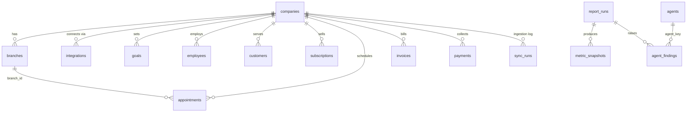

# 5. Database Design

Azure SQL Database (serverless). The source of truth for the schema is `jarvis/db/models.py`. The generated DDL for review is in `db/schema.sql`; regenerate it with `python -m jarvis.cli schema --dialect mssql`.

## 5.1 Principles

- **Multi-tenant by `company_id`.** Every operational row carries `company_id`, and `branch_id` where it applies. A new acquisition adds rows, not tables.
- **Source identifiers preserved.** Each operational row keeps `source_system` and `source_id`, unique per company. Re-syncs are idempotent upserts, and entities can load in any order.
- **Data minimization.** No customer names, addresses, phones, e-mails or payment instruments are stored. Metrics don't need them, which keeps the database out of PCI scope and limits breach impact.
- **Known vs unknown.** `sync_runs` records whether each entity loaded successfully for each window. That is how JARVIS distinguishes "zero cancellations" from "cancellations unavailable".
- **History for analytics.** Every computed value goes into `metric_snapshots`, which is the time series for Power BI, trend analysis and future agents.

## 5.2 Entity-relationship overview

## 5.3 Tables

| Group | Table | Key columns | Notes |
|---|---|---|---|
| Tenancy | `companies` | slug, name, timezone, workdays, acquired_on | `workdays` drives goal pacing (for example Mon-Sat) |
| | `branches` | company_id, slug, source_office_id | Maps a FieldRoutes office to a branch |
| | `integrations` | company_id, kind, config (JSON), secret_names (JSON) | Holds Key Vault secret **names** only |
| Operational | `employees` | source_id, name, role, active | technician / sales / office |
| | `customers` | status, date_added, date_cancelled, lead_source | No PII |
| | `subscriptions` | customer_source_id, service_type, status, date_added, date_cancelled, sold_by_source_id, initial/recurring price, annual_value | Sales and cancellations |
| | `appointments` | scheduled_date, completed_date, status (pending/completed/no_show/cancelled/rescheduled), technician_source_id, is_initial | Operations and production |
| | `invoices` | invoice_date, subtotal, tax, total, balance, appointment_source_id | FieldRoutes "tickets" |
| | `payments` | payment_date, amount, status, method | Collections |
| Goals | `goals` | company_id, branch_id (NULL = company), metric_key, period (daily/monthly), period_start, target, direction | A month-specific goal overrides a standing goal |
| Platform | `sync_runs` | entity, window_start/end, status (succeeded/failed/unsupported), records, error | Drives availability |
| | `report_runs` | report_type, scope, report_date (unique), status, facts, narrative, rendered_markdown, ai_used, delivered_at | Full reproducible record of what was sent |
| | `metric_snapshots` | company_id (NULL = portfolio), metric_key, period, value, status, detail | Time series |
| | `agents` | key, enabled, schedule, permissions (JSON) | Agent registry and permissions |
| | `agent_findings` | agent_key, company_id, severity, category, title, detail, status | Issues and recommendations, tracked to resolution |
| | `audit_log` | at, actor, action, target, detail | Append-only record of outbound actions |

Indexes cover the hot paths: `(company_id, <date>)` on every fact table, `(company_id, metric_key, period_end)` on snapshots, and `(company_id, status)` on findings.

## 5.4 Adding a company: the data steps

1. Add a YAML block (company, branches with office IDs, FieldRoutes subdomain, secret names, goals).
2. Run `python -m jarvis.cli tenants sync --file config/tenants.yaml`.
3. Put the credentials in Key Vault under those names.
4. The next run picks the company up automatically.
5. Optionally backfill history with `POST /api/reports/ceo-daily?date=...&force=true` for past dates, or a bulk-history job in Phase 2.

## 5.5 Power BI

Connect Power BI to the Azure SQL database with Entra ID (organizational account), using a read-only group (see `infra/post-deploy.sql`). Recommended starting model:

- Facts: `metric_snapshots`, `invoices`, `appointments`, `subscriptions`, `payments`.
- Dimensions: `companies`, `branches`, `employees`, plus a date table.

Phase 2 adds curated SQL views (`vw_daily_kpis`, `vw_technician_daily`) so reports don't depend on table internals.

## 5.6 Retention and backup

- Azure SQL automated backups with 7-day point-in-time restore (extend to 35 days if required).
- Operational data is kept indefinitely for trend analysis (small volume).
- `report_runs.facts` keeps the exact numbers behind every report sent.
- Log Analytics keeps logs for 30 days.
